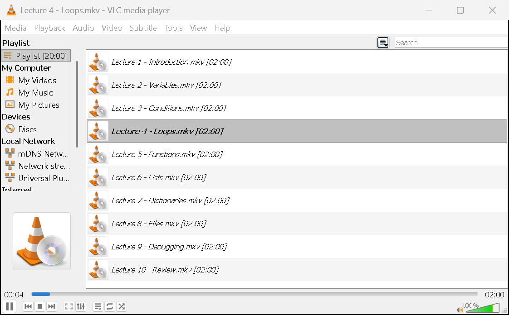
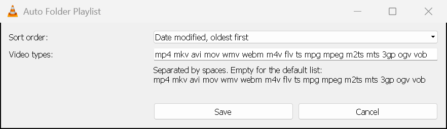

# vlc-autofolder

Open one video in VLC and the rest of its folder is added to the playlist automatically, so Next and Previous just work.

When you open a single video file in VLC 3.0 on Windows (for example by double-clicking it in File Explorer), a small Lua script that runs in the background adds every other video in the same folder to the playlist. It keeps them in your chosen sort order (date modified or natural name order), with the opened file in its correct place. The file you opened keeps playing. You don't have to open the folder or click anything.



## Status
In development. Built for VLC 3.0.24 on Windows 11. What works so far ([details](docs/guide.md#what-works)):
- **Opening a video** by double-click, Open File, or a drop on the video picture. Its folder goes at the end of the playlist; your own items stay.
- **Another folder** replaces the previous folder's videos; the same folder again leaves one copy of each file.
- **Large folders and network paths** (`\\server\share\...`, mapped drives).
- **[When VLC is already open](docs/guide.md#when-vlc-is-already-open):** whether a double-clicked video gets its folder depends on VLC's one-instance settings.

## Install
1. On GitHub, click **Code → Download ZIP**, then right-click the zip and choose **Extract All**.
2. Close VLC (every window).
3. Open the extracted folder, then the `vlc-autofolder-main` folder inside it, and double-click `install.cmd`. Windows asks "The publisher could not be verified. Are you sure you want to run this software?", because the file came from the internet: click **Run**. A window shows what it did; press any key to close it.
   It copies the Lua scripts into VLC's user folder and adds autofolder to VLC's settings file (vlcrc), after saving a copy of that file ([details](docs/guide.md#install-details)).
4. Start VLC and open any video.

- **"VLC's settings file isn't there yet":** VLC writes vlcrc the first time it starts. Start VLC, click Continue on its first-start question, close it, and run the install again.
- **Update:** get the new files and run the install again. It replaces the scripts; vlcrc and your settings stay as they are. What changed in each version: [CHANGELOG.md](CHANGELOG.md).
- **Uninstall:** close VLC and double-click `uninstall.cmd` (click **Run** if Windows asks). It removes the scripts, your Auto Folder settings (`autofolder.ini`) and only its own entry from vlcrc (after saving another copy). Other VLC settings you changed since the install are kept. The `.bak` copies stay; delete them when you no longer need them.

## Settings
In VLC, choose **View → Auto Folder Playlist settings**: the sort order (by date modified or by name, either way round; the default is date modified, oldest first) and the video file types. **Save** applies them without restarting VLC. The settings file and its values: [Sort order and video types](docs/guide.md#sort-order-and-video-types).



## Troubleshooting
- **Nothing is added after the install:** VLC loads the script only when it starts, so close every VLC window and start it again.
- **A double-click opens another player:** make VLC the default app for that file type.
- More fixes, and how to see what the script did: [Troubleshooting](docs/guide.md#troubleshooting). Known limits: [Limitations](docs/guide.md#limitations).

## Development
The tests run the real VLC 3.0.24 (a portable copy, so your own VLC settings are never touched) with no window. In Windows PowerShell, in this folder:
```powershell
powershell -ExecutionPolicy Bypass -File .\tests\setup-tools.ps1   # once: downloads the test VLC and luacheck into tools\
powershell -ExecutionPolicy Bypass -File .\tests\run-tests.ps1
```
The parts the tests can't reach (Explorer double-clicks, the dialog, the playlist window, the one-instance settings, install on your own VLC) are in the manual checklist, [docs/manual-test.md](docs/manual-test.md).

## Credits
- [VLC media player](https://www.videolan.org/vlc/) and its Lua scripting interface, by VideoLAN and the VLC authors (GPL-2.0-or-later).
- [PSScriptAnalyzer](https://github.com/PowerShell/PSScriptAnalyzer) by Microsoft (MIT): a development check only.
- [luacheck](https://github.com/lunarmodules/luacheck) by Peter Melnichenko and the Lunar Modules team (MIT): a development check only, downloaded by `tests\setup-tools.ps1`.

## License
MIT: see [LICENSE](LICENSE).
